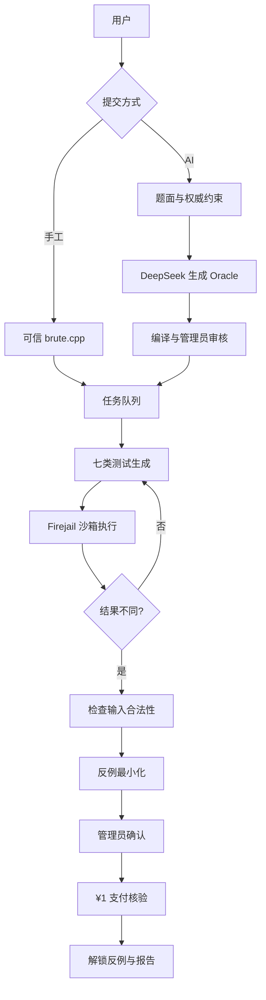

# WA Hunter Week 3–4 工作报告

> 课程：数据结构与算法 II  
> 项目：WA Hunter——自动反例搜索 Agent  
> 仓库：<https://github.com/LengAKNGX/WA-Hunter>  
> 演示站点：<https://lenga.com.cn>

## 一、阶段目标

在核心算法 MVP 能够自动对拍和最小化反例的基础上，本阶段将 WA Hunter 转化为可供他人使用的线上服务，并补齐从任务提交到付费交付的业务闭环。

主要任务包括：

1. 将命令行引擎接入 Web 服务；
2. 安全编译和运行用户提交的 C++ 程序；
3. 降低用户必须自行编写 `brute.cpp` 的门槛；
4. 防止 AI 或用户配置生成不符合原题约束的测试；
5. 增加任务管理、结果展示、支付核验和下载门禁。

## 二、线上服务建设

### 2.1 Web 功能

项目将已有轻量 OJ 改造成 WA Hunter 服务，当前提供：

- 用户注册、登录和退出；
- 新建手工 Hunt 和 AI Hunt；
- 查看个人任务和运行状态；
- 管理员审核 Oracle 和反例；
- 查看最小化反例及两份程序的结果；
- 付费后下载反例和完整报告。

后端采用 Python 标准库 WSGI 和 SQLite，Nginx 提供 HTTPS 入口，systemd 管理服务进程，适合部署在已有轻量服务器上。

### 2.2 用户代码安全执行

线上服务需要运行用户提交的代码，因此当前采取：

- Web 服务不以 root 身份运行；
- 使用专用低权限账户执行任务；
- 使用 Firejail 隔离用户程序；
- 默认禁止用户程序访问网络；
- 限制执行时间、内存、进程数和输出大小；
- 使用独立任务目录；
- 拒绝明显危险的系统调用；
- API 密钥和支付图片不进入 GitHub 仓库。

## 三、AI Oracle 模式

### 3.1 引入原因

手工模式要求用户同时提供 `solution.cpp` 和可信的 `brute.cpp`，普通用户可能只拥有待检查的程序。因此项目增加 AI Hunt：用户提交完整题面、候选程序和题目合法输入范围，由 DeepSeek Flash 辅助生成独立 Oracle。

### 3.2 独立性与审核

候选代码不会发送给模型，避免 Oracle 直接复制候选逻辑。AI 只接收题面、输入输出格式和用户填写的合法约束。

```text
AI 生成 Oracle
      ↓
后端格式与约束校验
      ↓
编译检查
      ↓
管理员人工审核
      ↓
进入任务队列
```

大模型只负责降低 Oracle 编写门槛。测试生成、程序执行、结果比较、反例缩减和任务状态推进仍由确定性程序完成。

## 四、反例可信性修复

### 4.1 非法反例问题

在测试洛谷 P1090 时，AI 曾把题目元素范围 `[1, 20000]` 扩大为 `[1, 2000000]`，系统随后生成：

```text
1
904648
```

候选程序的桶数组只能访问到约 `20000`，因此出现 `runtime_error(139)`。这个输入不符合原题约束，不能证明候选程序在原题上错误，也不能作为收费反例。

这说明差分不一致只是候选证据；只有输入合法、Oracle 可信且结果可复现时，才能认定有效反例。

### 4.2 权威约束机制

系统完成以下修复：

- 用户必须按题面填写合法的 `n` 和元素范围；
- 用户范围独立保存，不能被 AI 覆盖；
- AI 可以缩小测试范围，但不能扩大或偏离；
- 后端确定性检查 AI 范围是否为合法范围的子集；
- 结果页同时显示题目合法范围和实际测试范围；
- AI 越界时，任务在运行前直接被拒绝；
- 管理端增加“反例无效”状态，无效任务保留记录但不能收费。

系统还增加了“AI 范围子集通过”和“AI 擅自扩大范围被拒绝”等回归测试。

## 五、规模与资源预算

为了支持更多实际题目，线上参数调整为：

- 数组长度 `n` 最大支持 `100000`；
- 元素支持完整有符号 `long long` 范围；
- 总工作量满足 `测试轮数 × max_n ≤ 1000000`；
- 大规模任务自动降低测试轮数；
- 输入文件和程序输出继续受到大小限制。

该设计根据输入规模分配 Agent 的执行预算。`n` 较小时可以运行更多轮测试，`n` 较大时减少轮数，避免单个公开任务长期占用服务器。生成器支持大规模数据不代表任意暴力程序都能处理相同规模，Oracle 的实际范围仍受其复杂度限制。

## 六、¥1 支付与交付闭环

项目采用适合小规模课程实验的人工核验方案：

1. Agent 找到候选反例；
2. 管理员检查输入合法性和 Oracle 可信性；
3. 管理员发起 ¥1 支付请求；
4. 用户登录后看到微信和支付宝收款码；
5. 用户提交交易号后四位或付款备注；
6. 管理员确认到账；
7. 系统解锁完整反例和报告下载。

管理员尚未确认反例时不展示付款入口；未经付款的普通用户无法下载完整结果；无效反例不能请求付款。收款码存放在服务器私有目录，不进入公开仓库。

## 七、系统架构



## 八、测试与工程验证

自动化测试命令为：

```powershell
python -m unittest discover -s tests -v
```

当前 **14 项测试通过**，覆盖：

- 七种测试生成策略；
- 输入编码、差异判断和反例最小化；
- `long long` 边界与最小化精度；
- `n=100000` 和总生成量预算；
- AI 范围子集校验及越界拒绝；
- 复制候选代码作为 Oracle 的拒绝逻辑；
- 危险系统调用过滤；
- 付款状态和未付款下载限制。

主要提交包括：

| 提交 | 主要内容 |
|---|---|
| `2b7d83b` | 增加经审核的 DeepSeek Oracle |
| `1f30dfd` | 增加人工付款与交付门禁 |
| `8adb529` | 支持私有微信和支付宝收款码 |
| `300b8a5` | 增加端到端用户测试指南 |
| `41d70cd` | 明确小数据范围并拒绝复制 Oracle |
| `472a64b` | 扩展到 `n=10000` 和有符号 64 位数值 |
| `d80b5ba` | 将 `n` 上限提高到 `100000` 并增加工作量预算 |
| `0525109` | 强制执行用户权威约束并处理无效反例 |

## 九、成本与商业目标

项目复用已有轻量服务器，并使用 Python、G++、SQLite、Nginx 和 Firejail 等开源工具。核心差分测试和反例最小化不依赖付费 API。AI Hunt 使用 DeepSeek Flash，小额 API 费用属于开发投入，不是项目收入。

| 目标 | 状态 |
|---|---|
| 核心算法 MVP | 已完成 |
| 可公开访问的线上服务 | 已完成 |
| AI Oracle 辅助 | 已完成 |
| 支付和下载门禁 | 已完成 |
| 真实用户完成 ¥1 付款 | 尚未确认 |

技术产品已经形成，但课程要求的真实收入目标仍需通过实际用户付款完成。

## 十、阶段经验

1. 对拍不一致不等于合法 WA，必须优先验证输入约束；
2. LLM 能降低门槛，但不能成为题目约束的真值来源；
3. AI Oracle 必须保持独立，并经过编译检查和人工审核；
4. 公开服务需要限制总工作量，而不只是限制单个参数；
5. 收费必须发生在反例合法性确认之后；
6. 最小化反例是 WA Hunter 相比普通 OJ 的主要交付价值。

## 十一、下一步计划

1. 邀请同学按照 `USER_TEST_GUIDE.md` 完成真实任务；
2. 优先选择约束清晰、存在已知错误的数组类题目；
3. 完成第一笔 ¥1 交易并保存脱敏证据；
4. 记录任务运行时间、测试轮数、缩减前后规模和用户反馈；
5. 分类分析未找到、超时、Oracle 错误和约束填写错误等情况；
6. 完成商业验证后，再评估字符串、图或多组测试输入。

## 十二、阶段结论

Week 3–4 完成了 WA Hunter 从算法原型到基础产品的转变。系统已具备 Web 提交、AI Oracle、沙箱执行、权威约束、反例审核、支付核验和付费交付等流程。

本阶段最重要的改进不是增加大模型，而是通过非法反例事件建立“合法输入优先”的可信性原则。项目已具备完成商业闭环的基础条件，下一步应优先通过真实用户完成第一笔有效交易。

## 附录：主要材料

- `README.md`：项目说明
- `USER_TEST_GUIDE.md`：用户操作指南
- `SERVICE.md`、`server/README.md`：部署说明
- `SECURITY.md`：安全模型
- `server/app.py`：线上服务实现
- `tests/`：自动化回归测试

